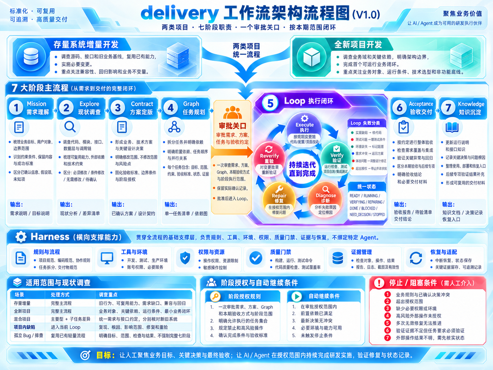
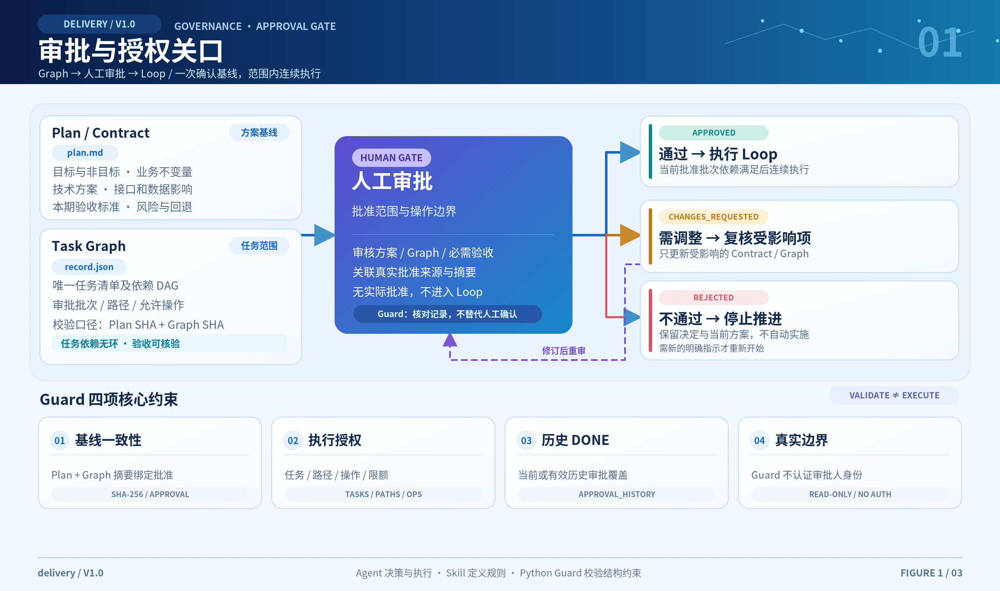
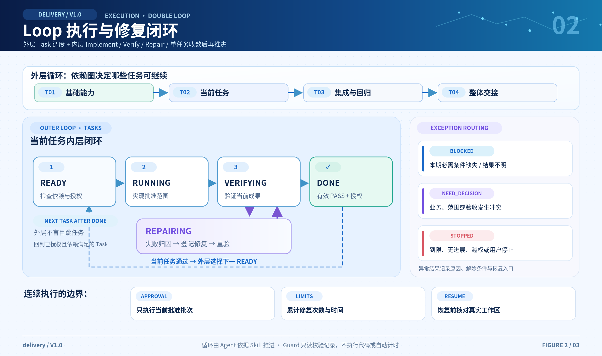
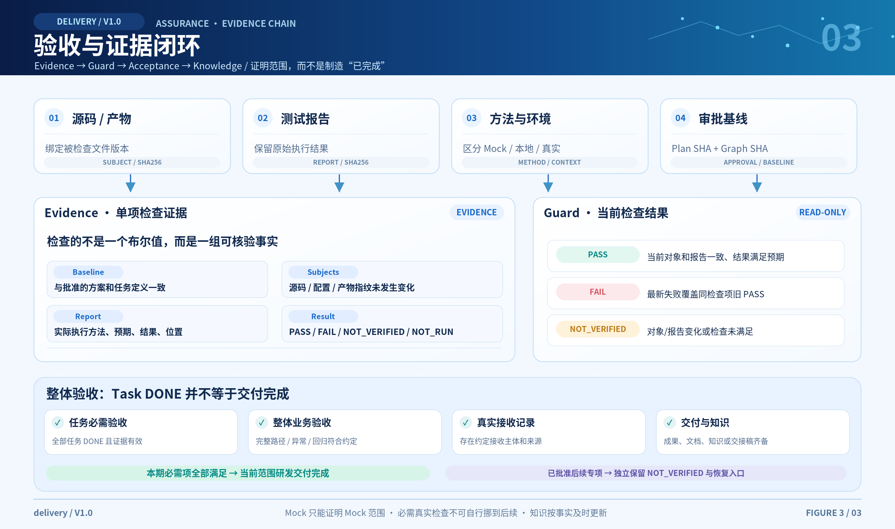

<p align="center"></p>

# delivery

**A lightweight, agent-agnostic workflow for approval-gated, evidence-based software delivery.**

[中文](README.md) · [MIT](LICENSE) · [CI](https://github.com/AIVORA988/delivery/actions/workflows/ci.yml)

delivery supports incremental development in existing systems and new projects. It establishes requirements and design baselines before implementation, coordinates work through human approval and task dependencies, and records verification evidence for acceptance and knowledge capture. It does not depend on a specific agent, model, toolchain, MCP server or cloud service.

Agents advance the workflow and perform development work. The Agent Skill defines behavioral rules; the Python Guard performs deterministic validation of records and referenced files. Users define goals, approve scope, make key decisions and accept deliverables.

Workflow V1.0, package 1.0.0, Python 3.10+, standard library only.

## Workflow architecture

[](docs/architecture.png)

[View the full-resolution diagram (Chinese)](docs/architecture.png)

## Quick start

Use a tool that supports Agent Skills in your target project. Every development request is planned and approved before implementation. Small changes use concise plans rather than skipping approval.

### 1. Install

```text
Install delivery from https://github.com/AIVORA988/delivery into the current project,
including all five Skills and the knowledge entry. Preserve existing rules, local changes and run records.
```

### 2. Describe the requirement

| Scenario | Example prompt | Task limit |
| --- | --- | --- |
| Small fix or feature change | `$delivery Fix the order-status filter.` | 3 per run |
| Complex existing-system change | `$delivery Add split shipments to this store.` | 15 per run |
| New medium or large system | `$delivery-feature Plan the store from the architecture and detailed design in docs/design, organized by Feature.` | 30 per Feature |

The agent investigates, defines the plan, dependencies and acceptance criteria, then waits for human approval. Complex changes require applicable business, API, data, failure, concurrency, consistency and compatibility design. New medium or large systems require architecture and detailed-design documents. Split oversized scopes or Features into reasonable boundaries instead of hiding independent work inside oversized tasks.

### 3. Approve and execute

Send this after reviewing and approving the plan:

```text
I approve the current plan and task list. Execute within the agreed scope and limits.
```

Request revisions when needed, then review the updated plan. Once approval permits implementation, the agent uses the corresponding execution Skill. Approval without permission to start is retained without executing. Ordinary plans run a Task Loop; Feature plans first let the developer select one or more approved Features, then advance in dependency order with a Task Loop inside each. Tasks do not need repeated approval.

Use `$delivery-run` or `$delivery-feature-run` to resume with the same plan, record and valid authorization. See [START.md](START.md) for installation and upgrades and [Usage](docs/usage.md) for a complete interaction (Chinese).

## Skill responsibilities

| Skill | Purpose |
| --- | --- |
| [`$delivery`](skills/delivery/SKILL.md) | Plan ordinary and existing-system requirements, define tasks and obtain approval |
| [`$delivery-feature`](skills/delivery-feature/SKILL.md) | Plan a new medium or large system from architecture and detailed design, defining Features, tasks, contracts and dependencies |
| [`$delivery-run`](skills/delivery-run/SKILL.md) | Execute or resume an approved ordinary plan through the shared Task Loop |
| [`$delivery-feature-run`](skills/delivery-feature-run/SKILL.md) | Select one or more Features, advance Features in order and run the Task Loop within each |
| [`$delivery-bootstrap`](skills/delivery-bootstrap/SKILL.md) | Explicit, scoped knowledge construction for an existing project, with source references and resumable coverage |

When an existing project needs a dedicated knowledge pass:

```text
$delivery-bootstrap Document the order and payment modules. Preserve existing documentation,
cite sources, distinguish unverified behavior and record where to continue.
```

All five Skills ship together and share the plan, record, Guard and knowledge rules. Bootstrap does not run during installation, modify application code or add a development stage. Skills guide the current agent; they do not launch a scheduler or additional agents. Discovery and invocation depend on the host.

## Feature selection and execution batches

After overall approval, `$delivery-feature-run` shows each Feature's name, task progress, module acceptance, authorization and unmet dependencies. Developers select one or more Features; hosts without a native multi-select control use a numbered conversation list. Cancellation or no response starts no work.

Unfinished prerequisites must be included explicitly or already have passed module acceptance. Missing prerequisites prompt a selection change rather than an automatic scope expansion. Complete the current Feature's tasks and module acceptance before moving to the next. Save actual progress, evidence, cumulative usage and continuation points, update relevant knowledge, and resume without rerunning still-valid DONE tasks.

[](docs/diagrams/feature-task-loop.svg)

Task limits count the whole Graph or each Feature, including completed tasks, rather than the current approval batch. Payment, authorization, migrations, public contract changes and shared rules retain appropriate design and validation depth regardless of patch size. Planning-only, deferred execution and module-specific instructions remain binding.

Selection only narrows existing authorization. Unapproved work, stale baselines and unmet prerequisites cannot start. Selected-scope completion, approval-batch completion and overall delivery are separate decisions. Changes to bound design or API files require review of approval and evidence; old PASS results do not automatically carry over. See the [record contract](skills/delivery/references/record.md) for internal commands and result fields (Chinese).

## Workflow and example

The seven stages are **Mission → Explore → Contract → Graph → Loop → Acceptance → Knowledge**. A separate **Approval Gate** sits between Graph and Loop.

| Term | Responsibility |
| --- | --- |
| Mission | Requirements understanding |
| Explore | Current-state investigation |
| Contract | Design finalization |
| Graph | Task planning |
| Approval Gate | Human approval of the baseline, scope and permitted operations |
| Loop | Execution and verification, failure classification, repair, reverification and recovery |
| Acceptance | Overall acceptance and delivery |
| Knowledge | Documentation and knowledge capture |

The approved baseline includes requirements, design, tasks and acceptance methods. Agents continue within the approved batch while respecting dependencies, scope and recorded limits. Material changes require review of the affected parts. Harness capabilities provide cross-cutting support for project rules, tools, environments, permissions, quality checks, evidence and recovery.

```bash
python examples/try_delivery.py
python -m unittest discover -s tests -v
```

The isolated fixture runs real local checks, demonstrates a blocked unapproved draft, current-scope completion with an unverified external followup, then invalidates evidence after source changes. Fixture approvals are synthetic, not real project acceptance.

## Workflow details

Click a diagram to view the full-resolution original (Chinese). See [Usage](docs/usage.md) for the corresponding steps.

### 01 · Approval and authorization gate

[](docs/diagrams/01-approval-gate.png)

### 02 · Execution and repair loop

[](docs/diagrams/02-execution-loop.png)

### 03 · Acceptance and evidence loop

[](docs/diagrams/03-acceptance-evidence.png)

## Core validation mechanisms

- **Approval baseline consistency**: approval is bound to plan and task-definition hashes. Material changes invalidate the baseline; routine progress updates do not.
- **Scenario and Feature constraints**: new runs enforce 3 / 15 / 30 tasks, with the last limit applied per Feature. Membership, dependencies and module acceptance are bound to approval; selection cannot expand authorization.
- **Task dependencies and authorization scope**: check acyclic dependencies, approved batches and path boundaries. DONE tasks require valid current or historical approval coverage.
- **Evidence validity**: source, artifact and raw-report fingerprints must match. Changed files invalidate the current result; historical evidence is retained.
- **Bounded repair and recovery**: validate recorded repair counts and elapsed time against limits, retaining cumulative usage and recovery details across interruptions. Unconfigured limits do not imply unlimited execution.
- **Separate task and overall acceptance**: task completion does not replace overall acceptance or required handoff materials. An acceptance fingerprint binds the receipt to the approval baseline, verification evidence and delivered files; changes do not carry an old receipt forward automatically.
- **Current delivery scope and follow-up validation**: explicitly approved follow-ups remain separate, while documentation and knowledge are updated as work progresses.

The read-only Guard is a deterministic validator of record consistency and referenced files. It does not execute or intercept project commands, measure elapsed time, authenticate reviewers, establish report authenticity, or enforce an operating-system sandbox. Agents and the agreed recipients remain responsible for actual operation authorization, changed-file scope, impact analysis and business acceptance under project rules. Installation success means CONFIGURED, not application correctness.

## Acceptance scope and evidence validity

Current-scope acceptance may use approved local, Mock, test-environment, source-review or demonstration methods. Conclusions apply only to the coverage actually verified; tasks need not pass through every environment tier. Required live-environment checks must pass within the current scope and cannot be silently deferred.

When all required task checks, overall acceptance, handoff materials and the agreed receipt are complete, the current delivery scope may be declared complete. Approved follow-up validation retains its own NOT_VERIFIED status and recovery entry. Documentation and knowledge evolve with actual decisions, implementation and executed checks; subsequent live results supplement those records.

## Project integration and implementation boundaries

The default files are `plan.md` for the reviewable plan and `record.json` for task state, approvals, evidence and handoff records. Agents maintain the internal records. Existing rules and local changes are preserved. Historical records retain their original hashes, approvals and counting rules without mandatory migration; validation fixes also apply to old records. New runs must declare a scenario. Small changes still need a concise plan and approval. Read-only investigation does not authorize implementation.

## Knowledge capture and reuse

**Initialize → Read → Reference → Update → Review → Reuse.**

Installation deploys all five Skills and creates only `docs/knowledge/README.md`, registering the path in `knowledge_paths`. Other files are created when useful:

```text
docs/knowledge/
├── README.md       Topic index, coverage and continuation points
├── project.md      Project overview and constraints
├── modules/        Module rules, interfaces and data relationships
├── decisions/      Significant decisions and applicability
├── guides/         Development, operation and verification procedures
├── lessons/        Reusable diagnoses, fixes and prevention
└── deliveries/     Delivery summaries with lasting reference value
```

Existing architecture, API and operations documents remain in place and are linked rather than duplicated. A confirmed empty knowledge base is skipped. Otherwise, agents retrieve relevant material, verify it against current sources, and explain what the plan adopts, updates or rejects. An outdated index or incomplete scan does not establish emptiness.

Required documentation changes belong to the approved task scope. Implementation updates affected topics; acceptance checks consistency, sources, limitations and relevant links. Capture scope, conclusions or steps, provenance, verification limits and the actual update date. No increment requires a reason, not a redundant document. Future requests retrieve and revalidate the knowledge; interrupted construction resumes from recorded coverage.

New projects still require a runnable first slice and applicable verification. Existing projects still require compatibility, invariants and regression checks. Knowledge supports these checks; it does not replace approval, evidence or overall acceptance. See the shared [knowledge rules](skills/delivery/references/knowledge.md) (Chinese).

The package supports direct Skill installation and a project-local setup script, with optional plugin manifests. It includes no independent background scheduler, complete programmatic workflow engine, operating-system permission sandbox, approval identity authentication or automatic production release capability.

[Workflow](skills/delivery/SKILL.md) · [Usage](docs/usage.md) · [Record contract](skills/delivery/references/record.md) · [Validation](docs/validation.md) · [Contributing](CONTRIBUTING.md) · [Security](SECURITY.md)
