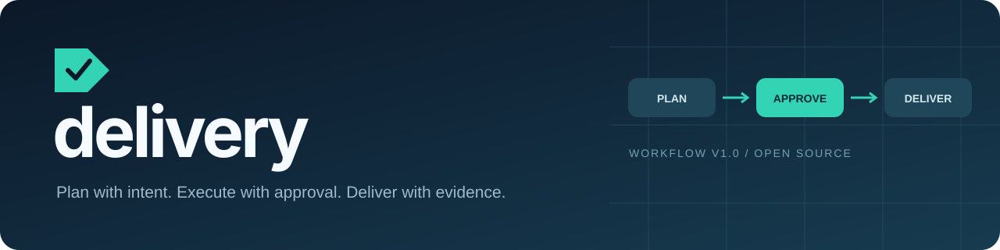
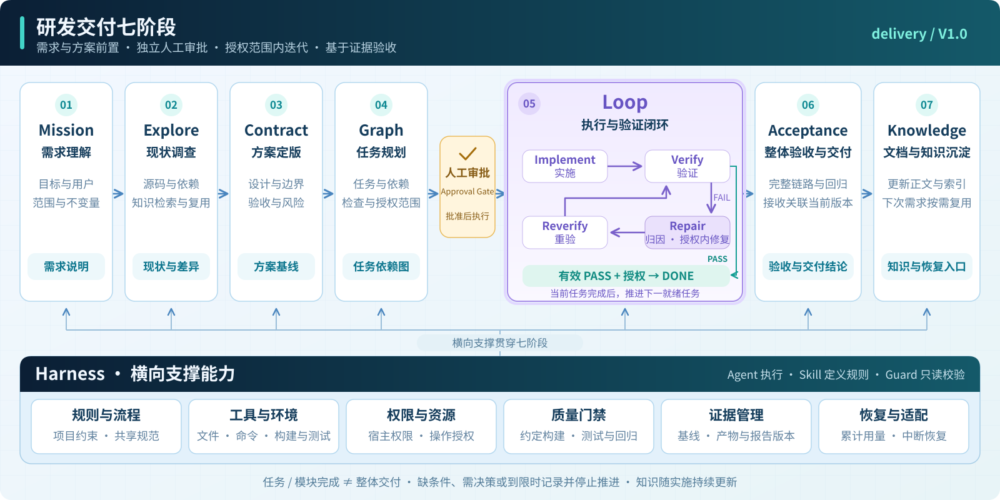
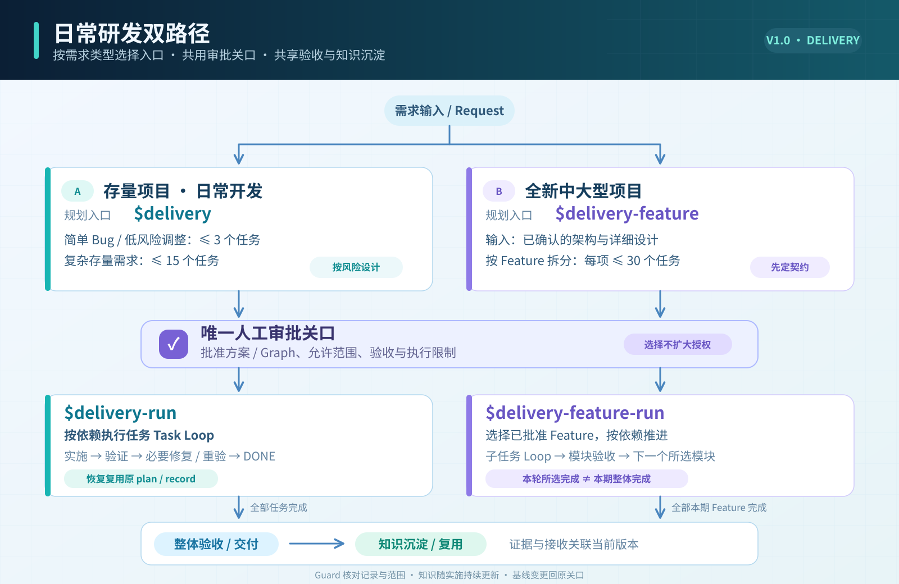
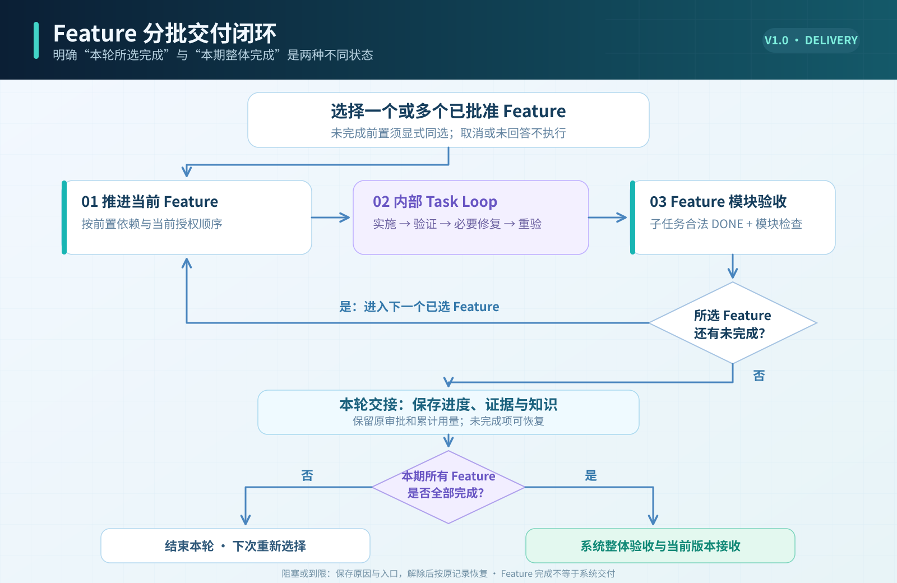
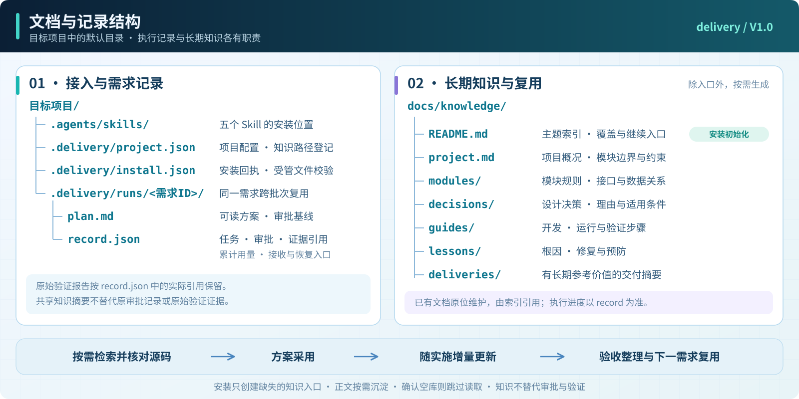

<p align="center"></p>

# delivery

**A lightweight, agent-agnostic workflow for approval-gated, evidence-based software delivery.**

[中文](README.md) · [MIT](LICENSE) · [CI](https://github.com/AIVORA988/delivery/actions/workflows/ci.yml)

delivery connects requirements and design, human approval, task execution, verification evidence and knowledge reuse. It supports existing systems and new projects without requiring a specific agent, model, toolchain or MCP server.

Users set goals, approve plans and accept deliverables. Agents investigate, design and implement. Skills define behavioral rules; the Python Guard validates records, file versions and authorization scope.

[Seven stages](#seven-stage-workflow) · [Quick start](#quick-start) · [Two development paths](#two-development-paths) · [Knowledge reuse](#knowledge-capture-and-reuse) · [Documentation and validation](#documentation-and-validation)

## Seven-stage workflow

[](docs/diagrams/seven-stage-workflow.svg)

**The independent Approval Gate sits between Graph and Loop.** Execution stays within approved scope. Completing tasks does not replace overall acceptance; knowledge is updated throughout implementation.

The **Loop** follows task dependencies through implementation, verification, failure diagnosis, authorized repair and reverification. **Harness** supports all seven stages with rules, tools, environments, host permissions, quality checks, evidence and recovery. Agents perform development work; Guard validates records without executing it. [Responsibilities and implementation boundaries](docs/design.md#职责分离与工具解耦) (Chinese)

## Quick start

Use an Agent Skills-compatible tool in the target project. The Python tools require **Python 3.10+** and only the standard library. Skill discovery and invocation depend on the host.

Without Python, investigation, Markdown planning drafts and authorized knowledge work can continue. Automated implementation, repair and final completion decisions wait until Guard can run; do not install a global runtime automatically.

### 1. Install

```text
Install all five Skills from https://github.com/AIVORA988/delivery into this project.
Initialize the knowledge entry; preserve existing rules, local changes and run records.
```

The agent follows `inspect → init → check`, installs the Skills in `.agents/skills/`, creates a missing `docs/knowledge/README.md` and registers its path. Installation does not analyze the codebase or run application tests. `CONFIGURED` means setup checks passed. [Manual installation, ZIP installation and upgrades](START.md) (Chinese)

### 2. Describe the requirement

| Scenario | Example prompt | Task limit |
| --- | --- | --- |
| Small bug fix or low-risk feature change | `$delivery Fix the order-status filter.` | 3 per run |
| Complex existing-system change | `$delivery Add split shipments to this store.` | 15 per run |
| New medium or large system | `$delivery-feature Plan the store from the detailed design I provide, organized by Feature.` | 30 per Feature |

The ordinary entry chooses design depth based on risk. Payment, authorization, migrations, public contracts and shared consistency rules need appropriate design even for small patches. For new medium or large projects, one detailed design is enough and can be uploaded as an attachment; no separate architecture document or `docs/design` location is required. The agent keeps a traceable project-local copy for approval and checks for essential gaps in its contents. Limits include completed tasks across approval batches; split oversized scopes into reasonable boundaries rather than combining unrelated work.

### 3. Approve and execute

The agent presents the plan, task dependencies, acceptance criteria, permitted operations and finite execution limits. After review:

```text
I approve the current plan and task list. Begin within the agreed scope and execution limits.
```

Request revisions when needed, then review the updated plan. Once approval permits implementation, the agent uses the appropriate execution Skill without asking for approval on every task. Planning-only, deferred-start and module-specific instructions remain binding. Invoking an execution Skill is not approval.

## Two development paths

[](docs/diagrams/daily-dual-path.svg)

| Skill | Responsibility |
| --- | --- |
| [`$delivery`](skills/delivery/SKILL.md) | Plan ordinary and existing-system requirements; prepare tasks and approval materials |
| [`$delivery-run`](skills/delivery-run/SKILL.md) | Execute or resume an approved ordinary plan through the dependency-aware Task Loop |
| [`$delivery-feature`](skills/delivery-feature/SKILL.md) | Plan a new medium or large system from a detailed design, including an attachment, with Features, interface contracts and both dependency graphs |
| [`$delivery-feature-run`](skills/delivery-feature-run/SKILL.md) | Confirm one or more approved Features; complete their tasks and module acceptance in order |
| [`$delivery-bootstrap`](skills/delivery-bootstrap/SKILL.md) | Build existing-project knowledge on explicit request; no application edits or prerequisite development stage |

Both paths share the seven stages above and the same plan and record. Material plan, task or bound design / API contract changes return to the original Approval Gate for review.

Detailed diagrams (Chinese): [Architecture](docs/architecture.png) · [Approval](docs/diagrams/01-approval-gate.png) · [Execution and repair](docs/diagrams/02-execution-loop.png) · [Acceptance and evidence](docs/diagrams/03-acceptance-evidence.png) · [Design and Harness boundaries](docs/design.md)

## Execution loop and recovery

Ordinary plans follow task dependencies: **implement → verify → classify failures → repair within authorization → reverify**. A task becomes `DONE` only with valid required evidence. Missing conditions, decision conflicts, exhausted limits and unknown external outcomes are recorded with recovery details, rather than retried blindly.

Feature authorization covers a complete module; once authorized, the current request may execute only specified tasks. Use Feature IDs or uniquely matching names already stated in the current request without asking again. When scope is missing or ambiguous, prefer native multi-select with a single submission; otherwise show the list and ask for all Feature IDs in one reply (e.g. `F01 F02 F03`). Validate and execute only after the complete selection is submitted; selecting the first item starts no work. Unfinished prerequisites must be explicitly included or already have passed module acceptance; selection never expands scope automatically. Execution is serial by default: finish the current Feature's tasks and module checks before advancing. Cancellation or no response starts no work.

[](docs/diagrams/feature-task-loop.svg)

Resume an ordinary plan through the original execution entry:

```text
$delivery-run Continue the approved plan. First check the workspace, evidence and cumulative usage.
```

For a Feature plan, invoke `$delivery-feature-run` with the current scope. Do not ask again when it is explicit, or silently reuse the previous selection; ask only when missing or ambiguous. Both reuse the original `plan.md` / `record.json` and valid authorization, retain approval history and cumulative limits, and skip still-valid DONE tasks. **Selected-scope completion, approval-batch completion and overall delivery are separate decisions.** [Interaction and recovery details](docs/usage.md) (Chinese)

## Acceptance and Guard boundaries

| Area | Current implementation |
| --- | --- |
| Approval and dependencies | Validate plan / Graph baselines, task / Feature dependencies, approved tasks and paths, and recorded cumulative repair / time limits; retain valid historical authorization for DONE tasks |
| Actual change scope | New Git-backed runs check cumulative staged, unstaged, untracked and committed changes. Agents retain a pre-operation checkpoint and use `--changes-since` to check new changes against the current task, preserving unchanged work from earlier batches. Legacy records and non-Git projects require manual review |
| Evidence | Check the current baseline, method, source / artifact and raw-report versions. File changes invalidate affected PASS results; historical evidence is retained |
| Final receipt | Generate a fingerprint after legitimate task completion, required task / module / overall checks and handoff. Bind evidence, delivery files and Git-visible result changes; actual acceptance must cover the current version and cannot be carried forward automatically |

Repairing a completed dependency chain requires reopening affected descendants and invalidating affected checks before resuming under the existing authorization and cumulative limits. The stronger result binding may invalidate older Git-backed acceptance fingerprints after an upgrade; tasks and approvals remain intact, but acceptance must be checked against the current result. [Execution and compatibility rules](skills/delivery/references/execution.md) (Chinese)

Managed maintenance verified against a complete install receipt and actual file hashes is reported separately. A pure Skill upgrade does not count as an unauthorized business change or invalidate a business receipt. Unlisted files, local edits and different staged content remain checked; evidence and deliverables that check the Skill itself still bind its version.

Approved acceptance methods may include source review, builds, tests, local execution, Mock or live environments. Conclusions apply only to verified coverage. Explicitly approved follow-up validation remains `NOT_VERIFIED`; required current-scope checks cannot be silently deferred. Separate module passes do not replace complete business-path, failure and regression checks.

Guard is a read-only deterministic validator. It does not run application tests, measure time, intercept commands or authenticate reviewers / recipients. Git checks cannot attribute changes among contributors or detect reverted transient writes, ignored untracked files or operations outside the project. Plan / record semantic consistency, report authenticity and business impact still need review. There is no background scheduler, complete workflow engine or permission sandbox. Installation and structural checks are not business acceptance. [Record contract](skills/delivery/references/record.md) · [Security](SECURITY.md) (Chinese)

## Knowledge capture and reuse

**Initialize → retrieve and check against source → use in the plan → update during implementation → review at acceptance → reuse in the next request.**

[](docs/diagrams/document-structure.svg)

These are the **default paths in a target project after setup**. `.delivery/runs/<run-id>/plan.md` holds the reviewable plan; `record.json` holds tasks, approvals, evidence references, usage and recovery. Long-term knowledge is indexed in `docs/knowledge/README.md`. Only the knowledge entry is initialized; other files and directories are created when useful. Skip confirmed empty knowledge, otherwise retrieve relevant topics and check them against current source and applicable versions. Maintain existing documents in place and link them from the index. Required updates belong to approved tasks and progress with implementation, without waiting for approved follow-up live validation. Preserve sources, verification limits and unknowns; explain when there is no increment instead of creating redundant documents. Agents maintain internal records; users need not edit JSON or hashes.

For a dedicated knowledge pass on an existing project:

```text
$delivery-bootstrap Document the order and payment modules. Preserve existing docs,
cite source evidence, distinguish unverified behavior and record where to continue.
```

New projects still need a runnable first slice; existing projects need compatibility and affected-path regression checks. Knowledge does not replace approval or verification. [Knowledge structure and reuse rules](skills/delivery/references/knowledge.md) (Chinese)

## Documentation and validation

| Document | Contents |
| --- | --- |
| [Installation](START.md) · [Usage](docs/usage.md) | Setup, upgrades, planning, approval, execution and recovery |
| [Design](docs/design.md) · [Record contract](skills/delivery/references/record.md) | Responsibilities, baselines, Guard and historical compatibility |
| [Local example](examples/local-delivery.md) · [Validation](docs/validation.md) | Runnable demonstration, tests, CI and coverage limits |

Reference documents and shared diagrams are in Chinese. From this repository root:

```bash
python examples/try_delivery.py
python -m unittest discover -s tests -v
```

The temporary fixture runs two real local checks. It demonstrates blocked unapproved execution, current-scope completion and evidence invalidation after a source change. Approvals and receipts are synthetic; no external business system is contacted.

Workflow **V1.0** · Package **1.0.0** · [MIT](LICENSE) · [Contributing](CONTRIBUTING.md) · [Changelog](CHANGELOG.md)
