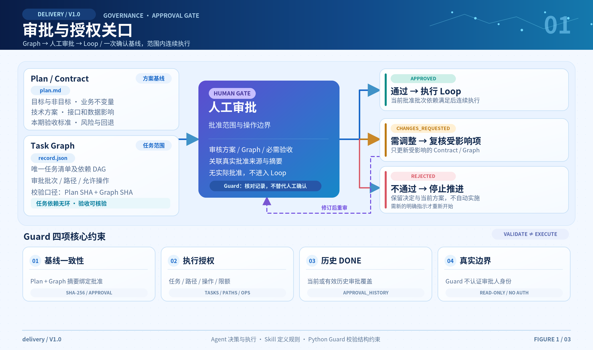
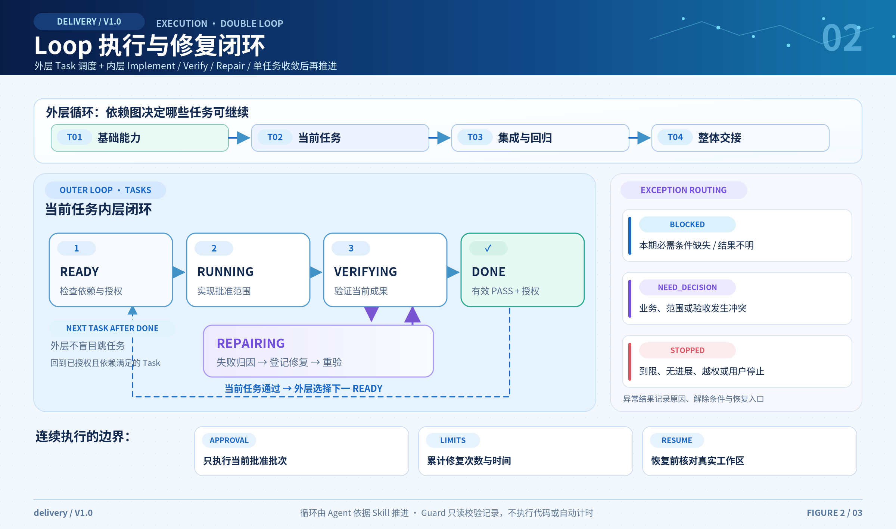
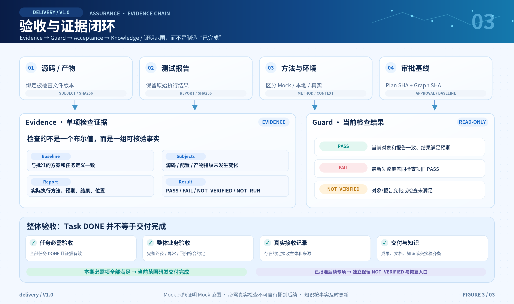

<p align="center"></p>

# delivery

**A lightweight, agent-agnostic workflow for approval-gated, evidence-based software delivery.**

[中文](README.md) · [MIT](LICENSE) · [CI](https://github.com/AIVORA988/delivery/actions/workflows/ci.yml)

delivery supports incremental development in existing systems and new projects. It establishes requirements and design baselines before implementation, coordinates work through human approval and task dependencies, and records verification evidence for acceptance and knowledge capture. It does not depend on a specific agent, model, toolchain, MCP server or cloud service.

Agents advance the workflow and perform development work. The Agent Skill defines behavioral rules; the Python Guard performs deterministic validation of records and referenced files. Users define goals, approve scope, make key decisions and accept deliverables.

Workflow V1.0, package 1.0.0, Python 3.10+, standard library only.

## Workflow architecture

[](docs/architecture.png)

[View the full-resolution diagram (Chinese)](docs/architecture.png)

## Quick start

Use a tool that supports Agent Skills in your target project and send these three prompts in order:

### 1. Install

```text
Install the delivery Skill from https://github.com/AIVORA988/delivery
into the current project and initialize it. Preserve existing rules and local changes.
```

### 2. Describe the requirement

```text
Use the delivery Skill to build a shopping WeChat Mini Program with product browsing,
a cart, checkout with WeChat Pay, and order lookup. First present the requirements,
design, task breakdown and acceptance methods. Wait for my approval before implementation.
```

### 3. Approve and execute

Send this after reviewing and approving the plan:

```text
I approve the current plan and task scope. Use the delivery Skill to implement it, verify the result,
perform overall acceptance and update the usage instructions. Keep any live-payment
checks pending when their prerequisites are unavailable.
```

See [START.md](START.md) for manual installation and conflict handling.

## Workflow and example

The seven stages are **Mission → Explore → Contract → Graph → Loop → Acceptance → Knowledge**. A separate **Approval Gate** sits between Graph and Loop.

| Term | Responsibility |
| --- | --- |
| Mission | Requirements understanding |
| Explore | Current-state investigation |
| Contract | Design finalization |
| Graph | Task planning |
| Approval Gate | Human approval of the baseline, scope and permitted operations |
| Loop | Execution and verification, failure classification, repair, reverification and recovery |
| Acceptance | Overall acceptance and delivery |
| Knowledge | Documentation and knowledge capture |

The approved baseline includes requirements, design, tasks and acceptance methods. Agents continue within the approved batch while respecting dependencies, scope and recorded limits. Material changes require review of the affected parts. Harness capabilities provide cross-cutting support for project rules, tools, environments, permissions, quality checks, evidence and recovery.

```bash
python examples/try_delivery.py
python -m unittest discover -s tests -v
```

The isolated fixture runs real local checks, demonstrates a blocked unapproved draft, current-scope completion with an unverified external followup, then invalidates evidence after source changes. Fixture approvals are synthetic, not real project acceptance.

## Workflow details

Click a diagram to view the full-resolution original (Chinese). See [Usage](docs/usage.md) for the corresponding steps.

### 01 · Approval and authorization gate

[](docs/diagrams/01-approval-gate.png)

### 02 · Execution and repair loop

[](docs/diagrams/02-execution-loop.png)

### 03 · Acceptance and evidence loop

[](docs/diagrams/03-acceptance-evidence.png)

## Core validation mechanisms

- **Approval baseline consistency**: approval is bound to plan and task-definition hashes. Material changes invalidate the baseline; routine progress updates do not.
- **Task dependencies and authorization scope**: check acyclic dependencies, approved batches and path boundaries. DONE tasks require valid current or historical approval coverage.
- **Evidence validity**: source, artifact and raw-report fingerprints must match. Changed files invalidate the current result; historical evidence is retained.
- **Bounded repair and recovery**: validate recorded repair counts and elapsed time against limits, retaining cumulative usage and recovery details across interruptions. Unconfigured limits do not imply unlimited execution.
- **Separate task and overall acceptance**: task completion does not replace overall acceptance, a recorded receipt or required handoff materials.
- **Current delivery scope and follow-up validation**: explicitly approved follow-ups remain separate, while documentation and knowledge are updated as work progresses.

The read-only Guard is a deterministic validator of record consistency and referenced files. It does not execute project commands, authenticate reviewers, establish report authenticity, or enforce an operating-system sandbox. Agents and the agreed recipients remain responsible for execution, impact analysis and business acceptance under project rules. Installation success means CONFIGURED, not application correctness.

## Acceptance scope and evidence validity

Current-scope acceptance may use approved local, Mock, test-environment, source-review or demonstration methods. Conclusions apply only to the coverage actually verified; tasks need not pass through every environment tier. Required live-environment checks must pass within the current scope and cannot be silently deferred.

When all required task checks, overall acceptance, handoff materials and the agreed receipt are complete, the current delivery scope may be declared complete. Approved follow-up validation retains its own NOT_VERIFIED status and recovery entry. Documentation and knowledge evolve with actual decisions, implementation and executed checks; subsequent live results supplement those records.

## Project integration and implementation boundaries

The default files are `plan.md` for the reviewable plan and `record.json` for task state, approvals, evidence and handoff records. Agents maintain the internal records. Existing project rules and local changes are preserved; existing plans and records may be reused without mandatory migration. Isolated investigations and minor fixes follow the project's lightweight process.

The package supports direct Skill installation and a project-local setup script, with optional plugin manifests. It includes no independent background scheduler, complete programmatic workflow engine, operating-system permission sandbox, approval identity authentication or automatic production release capability.

[Workflow](skills/delivery/SKILL.md) · [Usage](docs/usage.md) · [Record contract](skills/delivery/references/record.md) · [Validation](docs/validation.md) · [Contributing](CONTRIBUTING.md) · [Security](SECURITY.md)
