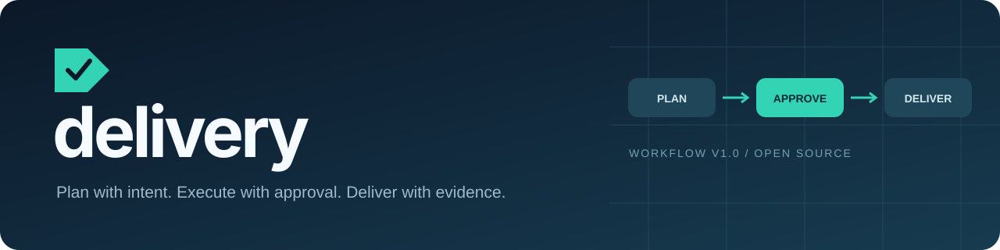
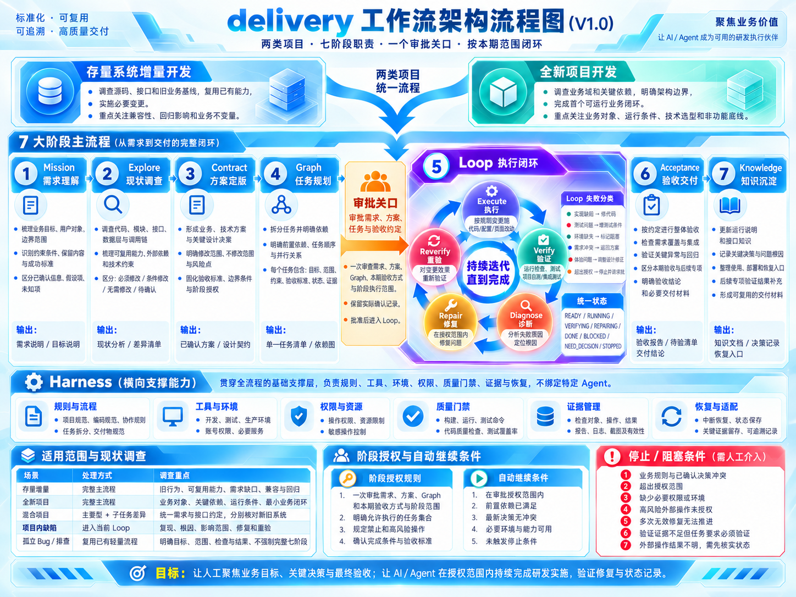
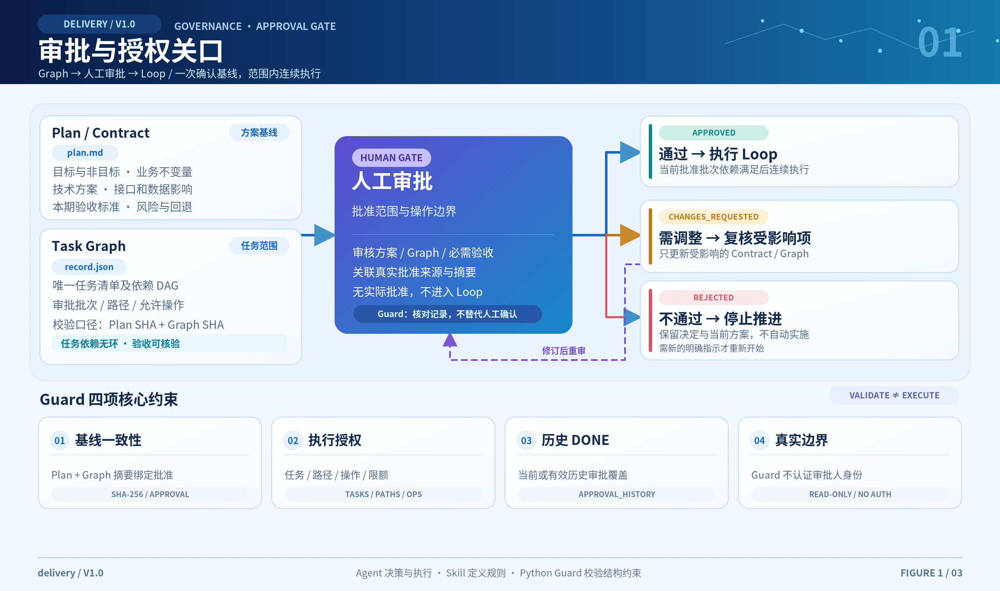
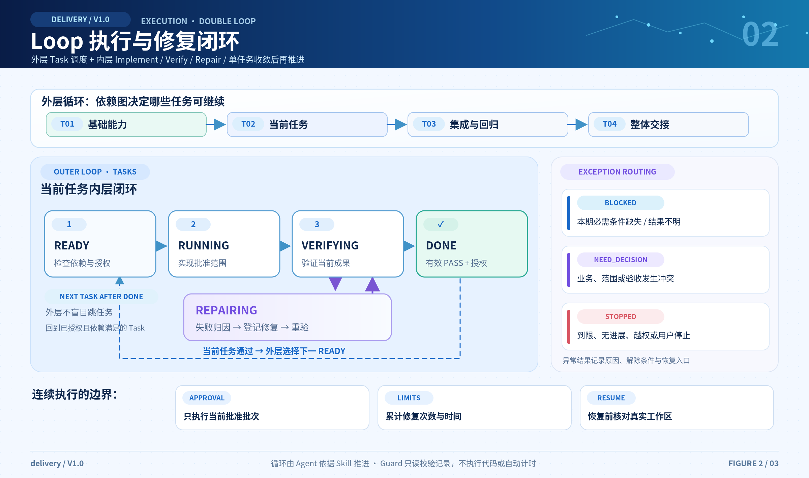
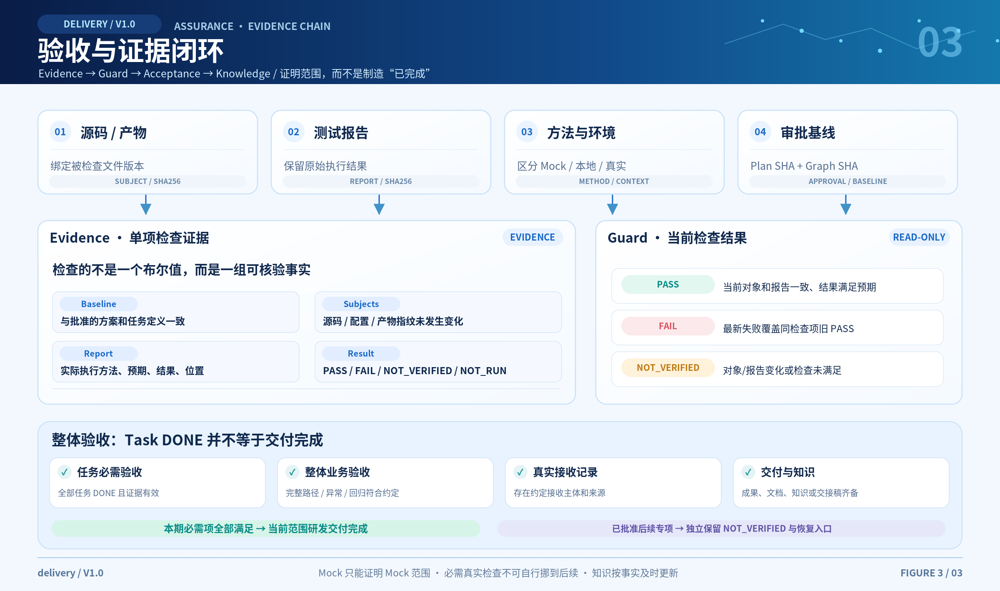

<p align="center"></p>

<p align="center">
  <a href="https://github.com/AIVORA988/delivery/actions/workflows/ci.yml"></a>
  <a href="LICENSE"></a>
  <a href="CHANGELOG.md"></a>
  
  <a href="README.en.md">English</a>
</p>

# delivery

**面向 AI Agent 的轻量级研发交付工作流**

需求与方案前置 · 人工审批授权 · 受控迭代执行 · 基于证据验收 · 持续知识沉淀

delivery 覆盖需求理解、现状调查、方案定版、任务规划、执行与验证闭环、整体验收与交付、文档与知识沉淀七个阶段，在任务规划与执行之间设置独立的人工审批关口。

通过明确的需求与方案基线、人工审批授权、任务依赖约束和可追溯的验证证据，规范 Agent 在授权范围内的研发执行过程。适用于存量系统增量开发与全新项目开发，不绑定特定 Agent、模型或工具链，不依赖特定 MCP 或云服务。

**[架构流程图](#架构流程图) · [快速开始](#快速开始) · [流程辅图](#关键流程辅图) · [运行机制与示例](#运行机制与示例) · [使用手册](docs/usage.md) · [工作流规范](skills/delivery/SKILL.md)**

## 架构流程图

[](docs/architecture.png)

[查看高清原图](docs/architecture.png)

## 快速开始

在目标项目中使用支持 Agent Skill 的工具。以下以需要完整设计与审批的商城需求为例；独立低风险修复可在安装后直接提需求，由 Agent 按风险分流。

### 1. 安装

```text
请从 https://github.com/AIVORA988/delivery 安装 delivery 到当前项目，部署两个 Skill 并初始化知识库，保留已有规则与本地修改。
```

### 2. 提需求

```text
使用 delivery Skill 开发一个支持微信支付的商城小程序，包含商品展示、购物车、下单支付和订单查询。先提交需求方案、任务拆分和验收方式，等我审批后再开发。
```

### 3. 审批执行

阅读方案并同意后发送：

```text
我批准当前方案和任务范围，请使用 delivery Skill 开始开发，完成后验证、整体验收并更新使用说明。已批准列为后续的真实支付检查保留待验。
```

手工安装与冲突处理见 [START.md](START.md)。

## 两个 Skill 入口

| 入口 | 适用场景 |
| --- | --- |
| `$delivery` | 日常研发：按需读取知识，完成需求、方案、审批、执行、验收和增量沉淀 |
| `$delivery-bootstrap` | 显式触发的存量知识构建：按项目或模块调查源码与已有资料，补齐知识和恢复入口 |

日常只需 `$delivery`。存量项目需要集中梳理知识时，可发送：

```text
$delivery-bootstrap 梳理当前项目的订单与支付模块，保留已有文档，记录源码依据、未验证范围和继续入口。
```

Bootstrap 不在安装时自动运行，不修改业务代码，也不是研发前置阶段。两个 Skill 同包部署；具体调用语法和自动发现由宿主支持决定。

## 日常修复、复杂设计与分批实施

日常只调用 `$delivery`，由 Agent 根据风险选择路径，不需要额外模式或 Skill：

| 场景 | 处理方式 |
| --- | --- |
| 独立低风险修复 / 单接口内部调整 | 明确目标和边界，沿用修复请求中的实际授权，直接定位、实施、针对性测试和必要回归；不强制新建方案、任务记录或知识正文 |
| 复杂或高风险需求 | 在原方案中完成适用的业务、接口、数据、异常、并发、一致性、兼容与验收设计，统一审批后实施 |
| 跨模块分批开发 | 统一设计与原 Graph，明确提供方 / 消费方契约、依赖及最终集成，多次调用复用同一记录和有效审批 |

轻量修复仍保留七阶段职责和实际授权核对；支付、权限、迁移、公开契约或跨模块规则变化不因代码量小而简化。标准需求内返修继续原 Loop。用户限制“只给方案”或“只执行本模块”始终有效。简短示例见 [使用手册](docs/usage.md)。

安装后按实际任务发送，例如：

- **轻量修复**：`$delivery 修复切换筛选后页码未重置的问题，保留普通翻页，检查必要回归。`
- **复杂设计**：`$delivery 为商城增加多仓库存预占与取消释放，先完成可审批的详细设计、任务规划和验收方案，审批后再实施。`
- **分批实施**：`$delivery 继续“库存预占”原需求，本轮只实施已批准的库存模块，复用原方案、契约和记录，完成模块验证后交接，不推进订单模块。`

外部稳定设计 / 接口文件可登记到原 record.contracts，内容变化会使审批及旧证据过期。Guard 可用 `--task` 检查具体任务；`batch_complete` 仅表示当前批准批次完成，最终集成和整体验收仍决定 `delivery_ready`。这些能力校验记录，不实时拦截 Agent 操作。

## 运行机制与示例

Agent 负责流程推进和实际研发执行，Skill 定义行为规范，Python Guard 作为确定性校验器核对记录与所引用文件。使用者负责目标、人工审批、关键决策与交付接收。

Harness 提供横向支撑能力，涵盖项目规则、工具、环境、权限、质量门禁、验证证据与恢复。

```bash
python examples/try_delivery.py
```

本地隔离示例实际执行检查，依次展示以下结果：

1. 草稿尚未批准，不能进入执行。
2. 测试夹具批准后，范围内任务可以执行。
3. 本期任务、整体验收与交接条件满足，已批准的后续真实环境专项仍独立保留未验证状态。
4. 修改已检查源码后，Guard 判定原 PASS 证据失效。

演示使用临时目录和虚构审批，不访问外部业务系统，不代表真实项目已经通过。逐步解释见 [本地交付示例](examples/local-delivery.md)。

## 方案基线、审批授权与受控执行

七阶段主流程：**Mission → Explore → Contract → Graph → Loop → Acceptance → Knowledge**。人工审批关口位于 Graph 与 Loop 之间。

| 环节 | 重点产物 | 进入下一步的依据 |
| --- | --- | --- |
| Mission：需求理解 | 目标、范围、业务不变量与成功标准 | 需求、假设与未知项明确 |
| Explore：现状调查 | 现有能力、事实来源与差异分析 | 复用依据、必要变更与关键依赖明确 |
| Contract：方案定版 | 业务与技术方案、本期验收、阶段授权 | 设计决策与实施边界明确 |
| Graph：任务规划 | 唯一任务清单、任务依赖与验收定义 | 任务可执行、可验证、可交接 |
| Approval Gate：人工审批关口 | 实际确认来源、审批基线、任务批次与允许操作 | 方案、任务与验收方式获得明确批准 |
| Loop：执行与验证闭环 | 执行、验证、失败分类、修复、重验与恢复 | 当前任务满足本期必需验收，累计限制保留 |
| Acceptance：整体验收与交付 | 需求覆盖、任务集成、异常回归与实际接收 | 本期必需检查和必要交付材料齐备 |
| Knowledge：文档与知识沉淀 | 决策、实现、运行说明、验证证据与后续入口 | 按当前事实持续更新，后续实测补充 |

## 关键流程辅图

点击图片查看高清原图，操作说明见 [使用手册](docs/usage.md)。

### 01 · 审批与授权关口

[](docs/diagrams/01-approval-gate.png)

### 02 · Loop 执行与修复闭环

[](docs/diagrams/02-execution-loop.png)

### 03 · 验收与证据闭环

[](docs/diagrams/03-acceptance-evidence.png)

## 核心校验机制

- **审批基线一致性**：审批绑定方案与 Graph 定义的摘要；验收、范围或依赖发生实质变更时原审批失效，常规进度更新不影响审批基线。
- **任务依赖与授权范围**：检测依赖环、缺失任务、依赖未满足及超出当前批准批次的活动；DONE 任务须有有效的当前或历史审批覆盖。
- **验证证据有效性**：源码 / 产物与原始报告摘要变化时，相关当前结果按未验证处理，保留历史证据。
- **有界修复与中断恢复**：核对记录中的累计修复次数与时间，未配置限制不视为无限执行；中断时保留原因与恢复入口。
- **任务完成与整体验收独立判定**：全部任务 DONE 后，仍须检查整体需求、集成结果、接收记录和必要交接材料。
- **本期验收与后续验证专项分别管理**：已批准的后续真实环境专项独立记录；文档与知识依据设计、实现和已执行检查持续更新。

Guard 只校验记录和所引用文件，不运行项目测试、不认证审批身份，也不证明报告真实性。实际执行、影响分析与业务验收仍由 Agent 和约定接收方按项目规则完成。

## 分层验收与证据有效性

本地、Mock、测试服务、源码审查或演示均可按批准的验收约定支持本期验收，结论限定在实际覆盖范围。不要求每个任务依次通过所有环境层级。本期明确要求的真实环境检查属于本期必需项，未满足时不能自行转为后续验证专项。

例如，本期约定交付页面与接口契约，使用本地和 Mock 验证业务路径；正式账号或部署联调已批准为后续验证专项。本期约定的验收与交接条件满足时，可以确认**本期研发交付完成**，同时保留正式联调的 **NOT_VERIFIED** 状态。文档与知识依据当前事实更新，后续实测补充验证证据。

## 轻量级集成与现有工程兼容

```text
your-project/
├── AGENTS.md                         原有规则保持原样
├── .agents/skills/
│   ├── delivery/                     日常入口、共享知识规则与 Python 工具
│   └── delivery-bootstrap/           存量知识构建入口
├── .delivery/
│   ├── project.json                  公共命令、规则与 knowledge_paths
│   ├── install.json                  两个 Skill 的安装摘要
│   └── runs/first-slice/
│       ├── plan.md                   供审批阅读的方案
│       └── record.json               Agent 维护任务、证据与交接
└── docs/knowledge/
    ├── README.md                     主题索引、覆盖范围与继续入口
    ├── project.md                    项目概况与核心约束
    ├── modules/                      模块规则、接口与数据关系
    ├── decisions/                    重要决策及适用条件
    ├── guides/                       运行、配置、测试与操作步骤
    ├── lessons/                      问题根因、处理与预防
    └── deliveries/                   有长期参考价值的交付摘要
```

方案与运行记录默认使用 `plan.md` 和 `record.json`。已有可靠的计划与记录时可直接遵循 Skill 规则，不强制迁移；孤立排查和微小修复沿用项目轻量流程。内部记录由 Agent 维护，使用者无需填写 JSON、内部编号或摘要。

## 知识沉淀与复用

**初始化入口 → 按需读取 → 方案引用 → 实施更新 → 验收整理 → 下一需求复用。**

- 安装只创建知识 README 和路径登记，上述其他正文与目录按需形成；已有架构、接口和运行文档保持原位，通过索引引用。
- 新项目确认空库后跳过空文档；有知识时按本次主题读取，并核对当前源码、适用版本和验证边界。索引过期或扫描受限不能直接判空。
- 方案中说明采用、更新或不适用的关键知识，必要文档更新纳入原任务和审批范围；执行时增量维护，验收时核对一致性、来源和相关链接。
- 正文保留适用范围、结论或步骤、来源、验证边界和实际更新日期。无增量说明理由，不为每个需求强制生成摘要，不把静态分析或 Mock 当作真实运行。
- 下次相关需求再次检索和核实；中断构建通过索引保留的覆盖路径、依据和待补入口恢复。

新项目仍需验证首个可运行闭环，旧项目仍需检查兼容、不变量与受影响路径回归。知识文档辅助调查，不替代审批、测试和整体验收。具体规则见 [knowledge.md](skills/delivery/references/knowledge.md)。

## 文档与示例

| 入口 | 内容与适用场景 |
| --- | --- |
| [START.md](START.md) | 第一次安装和接入项目 |
| [使用手册](docs/usage.md) | 规划、批准、执行、验收与恢复 |
| [Skill 主入口](skills/delivery/SKILL.md) | Agent 的七阶段职责和按需路由 |
| [知识构建入口](skills/delivery-bootstrap/SKILL.md) | 存量项目按范围分析与中断恢复 |
| [知识规则](skills/delivery/references/knowledge.md) | 目录、初始化、按需读取、沉淀与复用 |
| [项目接入](skills/delivery/references/setup.md) | 安装、升级、配置和故障处理 |
| [记录契约](skills/delivery/references/record.md) | 内部状态、审批摘要与证据校验 |
| [本地交付示例](examples/local-delivery.md) | 可运行场景与输出解释 |
| [验证说明](docs/validation.md) | 自动测试、CI 与校验范围 |
| [设计原则](docs/design.md) | Agent 无关、轻量记录与适用边界 |

## 开源信息

工作流 **V1.0**，分发包 **1.0.0**，Python **3.10+**，仅标准库。支持直接复制 Skill 或使用项目接入脚本，另附可选插件清单。

安装、审批、验证证据、验收与恢复的工程检查可重复执行。当前实现不包含独立后台调度器、完整的程序化流程执行引擎、操作系统权限沙箱、审批身份认证或自动生产发布能力。

[MIT License](LICENSE) · [贡献指南](CONTRIBUTING.md) · [安全说明](SECURITY.md) · [版本记录](CHANGELOG.md)

