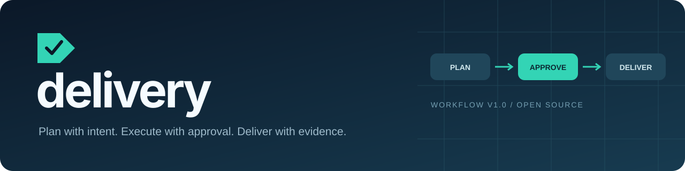
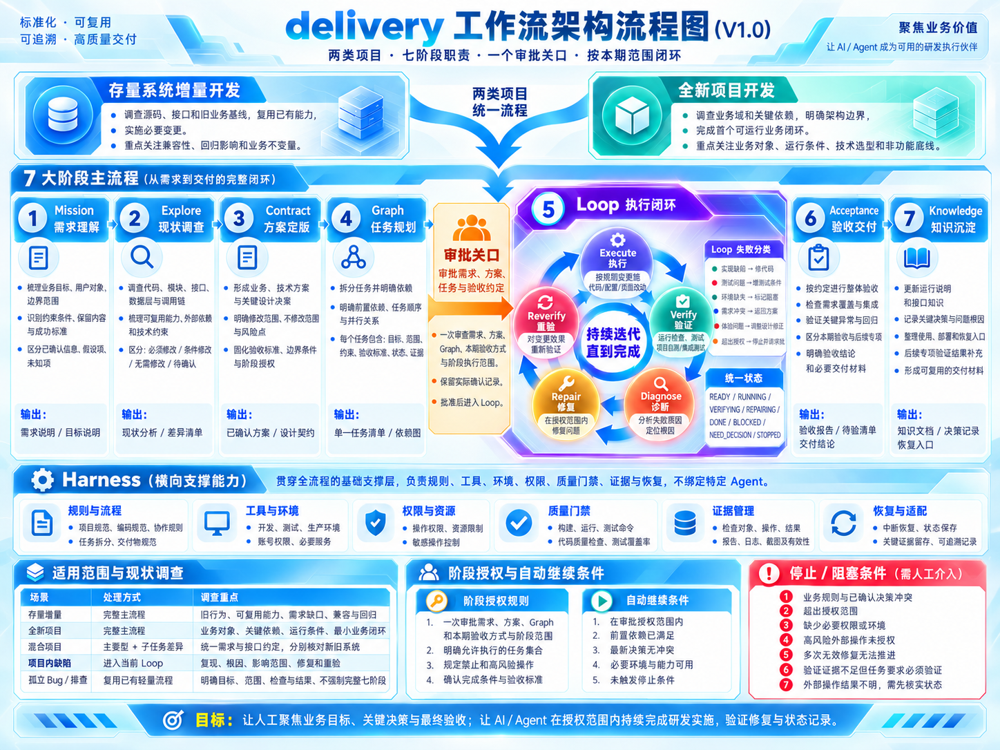

<p align="center"></p>

<p align="center">
  <a href="https://github.com/AIVORA988/delivery/actions/workflows/ci.yml"></a>
  <a href="LICENSE"></a>
  <a href="CHANGELOG.md"></a>
  
  <a href="README.en.md">English</a>
</p>

# 先把需求想清楚，再让 Agent 跑得稳

delivery 将**需求 → 现状 → 方案 → 任务拆分 → 审批 → 执行闭环 → 整体验收 → 知识沉淀**组织成可接手的工作流。适用于存量系统增量开发与全新项目首个业务闭环。

你负责目标、关键决策和接收；Agent 准备材料、按批准范围连续执行、整理证据和更新文档。用已有项目工具完成工作，不依赖固定模型、MCP 或云服务。

**[架构流程图](#架构流程图) · [快速开始](#快速开始) · [运行演示](#先看它如何工作) · [使用手册](docs/usage.md) · [工作流规范](skills/delivery/SKILL.md)**

## 架构流程图

[](docs/architecture.png)

[查看高清原图](docs/architecture.png)

## 快速开始

在目标项目中使用支持 Skill 的 Agent，依次发送以下三段 prompt：

### 1. 安装

```text
请从 https://github.com/AIVORA988/delivery 安装 delivery Skill 到当前项目，完成初始化，保留已有规则与本地修改。
```

### 2. 提需求

```text
使用 delivery Skill 开发一个支持微信支付的商城小程序，包含商品展示、购物车、下单支付和订单查询。先提交需求方案、任务拆分和验收方式，等我审批后再开发。
```

### 3. 审批执行

阅读方案并同意后发送：

```text
我批准当前方案和任务范围，请使用 delivery Skill 开始开发，完成后验证、整体验收并更新使用说明。真实支付条件不足的部分保留待验。
```

手工安装与冲突处理见 [START.md](START.md)。

## 先看它如何工作

```bash
python examples/try_delivery.py
```

一个隔离的本地演示会实际运行样例检查，依次展示：

1. 草稿尚未批准，不能进入执行。
2. 测试夹具批准后，范围内任务可以执行。
3. 本期任务、整体验收与交接满足，正式环境专项仍独立未验证。
4. 修改已检查源码后，旧 PASS 自动失效。

演示使用临时目录和虚构审批，不访问外部业务系统，不代表真实项目已经通过。逐步解释见 [本地交付示例](examples/local-delivery.md)。

## 一次规划，一处审批，范围内连续执行

| 环节 | 重点产物 | 进入下一步的依据 |
| --- | --- | --- |
| Mission / Explore | 目标、边界、不变量、来源与差异 | 主要需求可判断，现状和关键未知项清楚 |
| Contract / Graph | 业务技术方案、任务依赖、本期验收、阶段授权 | 任务可执行、可检查、可交接 |
| 审批关口 | 实际确认、批准版本、任务批次与允许操作 | 方案、任务与验收方式一起批准 |
| Loop | 执行、验证、诊断、修复、重验 | 当前任务按本期必需验收判定，累计限制保留 |
| Acceptance | 需求覆盖、任务集成、异常回归与实际接收 | 本期必需检查和必要交付材料齐备 |
| Knowledge | 决策、实现、运行说明、证据与后续入口 | 按当前事实及时更新，后续实测补充 |

## 为交付补上的六个检查点

- **审批绑定当前方案**：计划与 Graph 定义的摘要绑定审批；改验收、范围或依赖会使旧批准过期，常规进度更新不会。
- **任务依赖与批次边界**：检测依赖环、缺失任务、越过依赖和超出当前批准批次的活动。
- **PASS 绑定被检查对象**：源码 / 产物与原始报告摘要改变，相关当前结果回到未验证；历史证据保留。
- **修复可以收敛和恢复**：登记修复与时间累计，空限制不代表无限重试，中断保留原因与入口。
- **任务完成与整体验收分开**：全部任务 DONE 之后，还检查整体需求、集成结果、接收记录和必要交接材料。
- **本期与后续分别判断**：已批准为后续的真实环境专项独立管理；文档与知识可以根据设计、实现和已执行检查及时更新。

校验器只核对记录和所引用文件，不运行项目测试、不认证审批身份，也不证明报告未伪造。规则、工具和实际业务判断共同完成交付。

## 验收有范围，证据有边界

本地、Mock、测试服务、源码审查或演示，都可以在批准范围内支持本期验收。只有本期明确要求的真实检查才成为本期门槛；不能把未通过的必需项自行挪到后续。

例如，本期约定交付页面与接口契约，使用本地和 Mock 验证业务路径；正式账号或部署联调已批准为后续。当前约定验收与交接满足时，可以确认**本期研发交付完成**，同时保留正式联调的 **NOT_VERIFIED**。文档知识现在更新，实测结果以后补充。

## 轻量接入，保留你的项目习惯

```text
your-project/
├── AGENTS.md                         原有规则保持原样
├── .agents/skills/delivery/           项目内 Skill、脚本和参考规则
└── .delivery/
    ├── project.json                  公共命令、规则与知识位置
    ├── install.json                  安装摘要与冲突检查
    └── runs/first-slice/
        ├── plan.md                   供审批阅读的方案
        └── record.json               Agent 维护任务、证据与交接
```

已有可靠的计划与记录可以继续使用规则模式；孤立排查和微小修复沿用项目轻量流程。机器记录由 Agent 维护，使用者无需填写 JSON、内部编号或摘要。

## 文档与示例

| 入口 | 适合谁 / 解决什么 |
| --- | --- |
| [START.md](START.md) | 第一次安装和接入项目 |
| [使用手册](docs/usage.md) | 规划、批准、执行、验收与恢复 |
| [Skill 主入口](skills/delivery/SKILL.md) | Agent 的七阶段职责和按需路由 |
| [项目接入](skills/delivery/references/setup.md) | 安装、升级、配置和故障处理 |
| [记录契约](skills/delivery/references/record.md) | 内部状态、审批摘要与证据校验 |
| [本地交付示例](examples/local-delivery.md) | 可运行场景与输出解释 |
| [验证说明](docs/validation.md) | 自动测试、CI 与校验范围 |
| [设计原则](docs/design.md) | Agent 无关、轻量记录与适用边界 |

## 开源信息

工作流 **V1.0**，分发包 **1.0.0**，Python **3.10+**，仅标准库。支持直接复制 Skill 或使用项目接入脚本，另附可选插件清单。

已建立可重复的安装、审批、证据、验收与恢复检查。这里没有后台调度器、操作系统权限沙箱或自动生产发布。

[MIT License](LICENSE) · [贡献指南](CONTRIBUTING.md) · [安全说明](SECURITY.md) · [版本记录](CHANGELOG.md)

