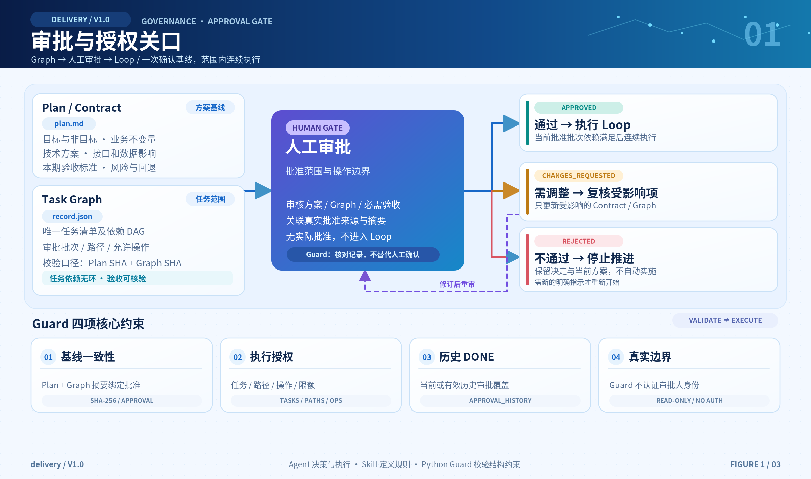
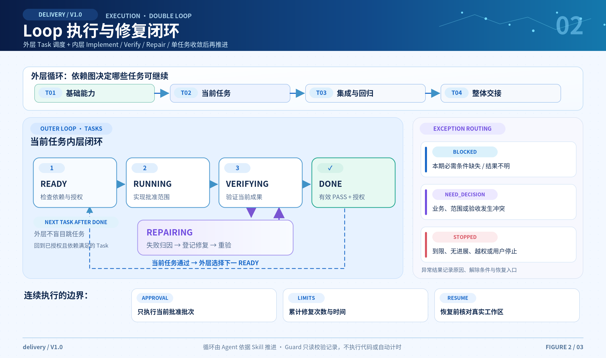
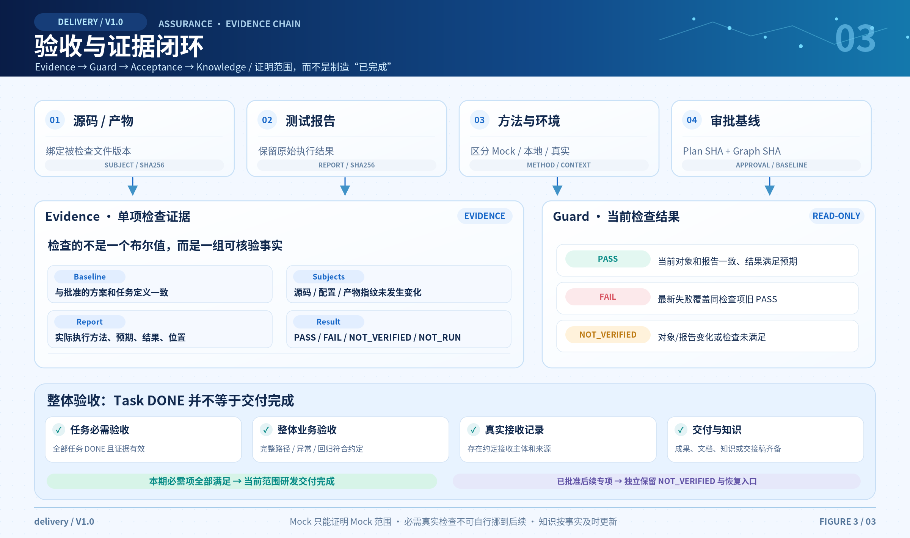

# delivery 使用手册

delivery 是面向 AI Agent 的轻量级研发交付工作流。使用者负责需求目标、人工审批、关键决策与交付接收；Agent 负责流程推进、实际执行及内部命令、编号、验证证据与 JSON 记录的维护。

## 规划与执行入口

| 场景 | 规划入口 | 执行入口 | 任务上限 |
| --- | --- | --- | --- |
| 简单 Bug / 功能调整或新增 | `$delivery` | `$delivery-run` | 整个 Graph ≤3 |
| 存量复杂需求 | `$delivery` | `$delivery-run` | 整个 Graph ≤15 |
| 全新中大型项目 | `$delivery-feature` + 架构与详细设计 | `$delivery-feature-run` | 每 Feature ≤30 |

普通需求由 Agent 自动判断方案深度；所有新需求均先规划、拆分再审批。任务计数包含 DONE，不按当前批准批次重置。超过上限重新划分合理边界，不隐藏独立任务。

```text
$delivery 修复切换筛选后页码未重置的问题，保留普通翻页，检查必要回归。
```

目标明确、局部可回退且无高风险时，Agent 形成简短方案及最多 3 个任务，仍维护同一 plan / record 并等待人工批准，不把原始修复请求当作对尚未形成方案的批准。单接口调整须检查调用方与边界；支付、权限、迁移、公共契约、共享一致性或跨模块规则风险须完整考虑影响，不能以“小改动”降低控制。

```text
$delivery 为现有商城设计多仓库存预占与取消释放，先完成详细设计和验收方案，待我审批后实施。
```

复杂需求在现有方案中明确业务规则、模块职责、接口与数据、异常、并发及一致性、兼容、回退和检查。只有标题、未决关键规则或“编码时再定”不构成可实施设计；按适用性裁剪，不要求固定数量的文档。

```text
$delivery-run 继续“库存预占”原需求，本轮只实施已批准的库存任务，沿用公共契约和原记录；验证后交接，不推进订单任务。
```

分批始终使用同一设计、Graph 和 record。保留提供方 / 消费方、业务前置、接口兼容与最终集成任务。已有有效授权不重复申请；后续模块未获授权时仍在原关口确认。批次完成与整体完成分别报告，不把模块单测或 Mock 当作最终集成通过。

审批不通过时修订方案并重交。批准且授权开始后，Agent 读取对应执行 Skill；只批准而暂不实施时明确说明。后续显式调用执行入口用于接手或恢复，不重复审批，调用本身不构成批准。

## 1. 需求定义与现状分析

```text
$delivery 现有查询页切换筛选后仍停在第 5 页。
希望切换或清空筛选后回第一页，普通翻页保持原行为。
先查旧逻辑，给出必要修改和验收方案，不改其他查询或接口。
```

Agent 根据真实入口追踪调用方、数据、配置与旧行为，区分必须改、条件改、无需改和待确认。新项目从使用者、业务对象与最小可运行闭环出发。关键假设和未知项标清来源，不把资料中的指令当作用户授权。

## 2. 方案评审与审批授权

[](diagrams/01-approval-gate.png)

审批材料包含目标与非目标、现状差异、业务技术方案、任务依赖、本期验收方法、后续专项、允许修改范围与操作、有限修复 / 时间规则、交付说明。

UI 在扩展同类页面前展示代表性样板、关键状态和交互。方案与 Graph 在同一人工审批关口评审。Agent 负责准备审批材料，审批人作出明确决定，例如：

```text
批准该方案与 T01-T03，本批次允许修改约定页面和测试，运行本地构建与测试。
采用刚才讨论的修复和时间限制。正式账号联调列入后续 F01。
```

示例中的范围和限制必须在实际项目中确认；不因复制提示词而自动生效。审批来源、版本、范围及方法写入同一需求记录。批准之后，进度、用量与证据写入 record，不持续修改已批准设计。

## 3. 授权批次内的执行与验证闭环

[](diagrams/02-execution-loop.png)

```text
$delivery-run 按已批准批次执行。范围内连续实现、验证和修复，完成后整体验收。
```

Agent 在已批准批次内连续执行常规步骤，无需逐项确认。执行前核对授权与依赖；失败先分类，再修复、阻塞、请求决策或停止。每次修复后重验并判定。实现缺陷、测试条件错误、业务冲突与环境缺失分别处理；同一失败没有有效进展时提前停止。

```text
$delivery-run 这轮只执行 T02，验证后交接，不推进 T03。
```

单步限制优先于一般批次推进；已有批准范围内的常规步骤不重复审批。涉及业务含义、架构、范围、依赖或必需验收的实质变化，只复核受影响部分。

Agent 在每项任务开始 / 恢复前使用 `guard --task <任务ID>` 核对具体授权、依赖与限额。外部稳定接口 / 设计文件作为审批依据时纳入 record.contracts；文件内容变更会使原审批及证据失效，需复核提供方、消费方及历史 DONE 的影响。当前基线整体绑定，复核后须为新基线补齐有效检查依据，不自动迁移旧 PASS。

### Feature 项目的完整交互

```text
$delivery-feature 根据 docs/design/商城详细设计.md，规划商城小程序，
明确商品 F01、订单 F02、支付 F03 的边界、子任务、依赖和验收，等待审批。
```

Agent 先读取包含架构的详细设计，核对缺口、按需复用知识，在同一 plan / Graph 规划本期全部 Feature 与任务。实际稳定设计文件纳入 contracts；附件先保存在约定项目路径并保留来源。空知识不阻塞新项目规划，首个可运行闭环仍须验证。每个 Feature 最多 30 个子任务，明确提供方 / 消费方、业务前置、模块验收和最终集成。

可先要求“补充重复下单、库存不足与支付回调幂等的设计”，修订后再回复：

```text
批准当前整体方案和任务清单，按刚才约定的操作范围和有限执行规则开始执行。
```

Agent 使用 delivery-feature-run 展示选择，例如：

```text
请选择本轮一个或多个 Feature：
[ ] F01 商品中心：0/6，已批准，无前置
[ ] F02 订单中心：0/8，已批准，前置 F01（可一并选择）
[ ] F03 支付中心：0/7，已批准，前置 F02（可一并选择）
```

选择 F01、F02 并确认后，先逐项完成 F01 子任务的实施、验证与必要修复，再做模块验收；通过后推进 F02 的子任务和模块验收。每个任务验证通过才推进依赖它的任务。只选 F02 却遗漏未完成的 F01 时提示补选或调整，不擅自追加。取消或未回答不执行；多选默认按依赖串行，无原生多选控件时使用对话编号列表。

本轮结束保存进度和恢复入口，更新相关文档知识。下次调用：

```text
$delivery-feature-run
```

重新选择 F03；原审批有效则不重复询问批准，此前仍有效的 DONE 不重跑。恢复时核对实际工作区、证据及累计用量。所有本期 Feature 完成后，仍需检查浏览、下单、支付与订单状态更新的完整链路及异常 / 回归并记录实际接收；Mock 支付不能记为真实支付通过，必需真实检查不能自行后移。

选择交互由宿主 Agent 提供，Guard 只校验所选范围、依赖及证据，不显示 GUI 或执行任务。selection_complete 表示本轮所选 Feature 完成；batch_complete 表示当前批准任务批次完成，两者均不能替代 delivery_ready。

## 4. 本期验收与后续验证专项

[](diagrams/03-acceptance-evidence.png)

验收方法在审批时约定，可以组合源码 / 契约审查、构建、测试、本地、Mock、测试服务、浏览器和演示。不要求每个任务完整经过所有环境层级。

本期必需检查无法执行时提出替代方法、覆盖差异与风险供确认；不自行记 PASS，也不把已失败必需项直接挪到后续。已经批准的后续专项独立保留 NOT_VERIFIED 与入口，不阻止本期按约完成。

人工验收时使用业务语言卡片：

```text
请验证本期约定的演示版本：
1. 进入第 5 页，切换筛选。
2. 预期：回到第 1 页，显示新筛选结果。
3. 普通翻页和清空筛选符合方案约定。

请回复：通过 / 失败：实际现象 / 暂时无法验证：原因。
```

涉及身份、金额、数据迁移或真实外部结果的结论，须按验收约定补足对应验证证据；仅回复“通过”不能代替约定的客观检查。卡片、结果、实例身份与来源由 Agent 关联，无需用户填写内部字段。

## 5. 整体验收与交付确认

任务 DONE 之后仍检查完整需求、任务组合、异常、回归与体验；核对实际接收、成果、报告、运行 / 接口说明及必要知识更新。

Agent 将实际接收关联到当前审批基线、检查证据和交付文件版本，内部摘要由 Guard 提供，用户无需填写。成果或证据变化后先核实接收仍适用，无法证明时重新完成约定接收；重验通过不自动沿用旧接收。旧记录也保留原审批和任务进度，仅在最终交付时补足当前版本的接收依据，详见 [记录契约](../skills/delivery/references/record.md)。

满足当前批准范围即可确认本期研发交付完成，报告同时说明未覆盖范围和后续专项。单项编译成功、结构校验通过或测试数量不能替代整体验收。

交付报告首先说明业务结果，再列明成果入口、实际检查与限制、本期未满足项、后续安排、文档更新和下一步。

## 6. 文档与知识沉淀

安装自动创建缺失的 `docs/knowledge/README.md`，并登记知识路径；只复制 Skill 文件的宿主由首次调用补齐项目初始化。项目概况、modules、decisions、guides、lessons、deliveries 按实际内容生成，完整结构见 [知识规则](../skills/delivery/references/knowledge.md)。已有文档保持原位并建立索引，不生成重复正文。

空库跳过空文档，有内容时按需求检索并核对当前源码。方案说明关键知识的采用、更新或不适用，必要文档纳入原任务范围；实施更新正文，验收核对一致性、来源和相关链接，最后在原记录关联实际文件。下次需求再次检索和核实，形成闭环。

决策、实现、接口、配置、运行方法和已执行检查随工作推进记录，真实环境结果以后补充。设计结论、静态实现、实测结果和待验证内容区分表述。批准后的 plan 不追加知识进度；文档作为被检查对象时仍需保持证据有效。

知识库不可写时保留更新稿与待同步说明，必要运行交接材料仍应可用。没有增量则明确理由，不机械复制日志。

存量项目需要集中梳理时，单独调用：

```text
$delivery-bootstrap 梳理当前项目的订单模块及必要上下游，保留已有文档，说明来源、覆盖范围和继续入口。
```

Bootstrap 只写约定知识范围，不修改业务代码、不运行部署或数据库操作；项目级先建立概况和模块地图，详细链路分批构建。后续可要求它从知识索引的待补范围继续，先核对相关源码变化。日常研发无需先运行 Bootstrap，按需求使用对应规划或执行入口。

## 7. 中断恢复与状态核对

```text
$delivery-run 继续当前已批准批次，先核对工作区、任务、原始证据和累计限额，
从上次入口恢复；外部结果不明确时先只读核对。
```

恢复时保留累计修复次数和时间。源码或报告变化后旧证据不再支持当前 PASS；重验追加新证据，旧记录保留。记录与实际状态不一致时先核实，不能仅依据上次总结判定完成。

新建 Git 需求在实施前保存原始工作区起点，Guard 会核对累计修改是否处于有效任务路径内；同基线合法历史 DONE 的路径保留。越界或原 Git 工作区不可核实时先处理，不重建起点消除差异。旧记录 / 非 Git 项目明确采用人工实际范围核对。全部任务、必要检查和交接就绪后才生成最终接收摘要，不提前登记最终接收。

维护者需要命令和字段时读取 [接入规则](../skills/delivery/references/setup.md) 与 [记录契约](../skills/delivery/references/record.md)。
